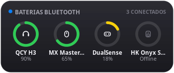

# iOS Bluetooth Battery Monitor (`ios-bluetooth-battery@dalvan`)

A **Cinnamon Panel Applet** dedicated to monitoring connected **Bluetooth & Wireless device batteries** with an **iOS / macOS Sonoma Batteries Widget** popover and a **4-layer high-compatibility detection engine**.



## Multi-Backend High Compatibility

Different Bluetooth headphones, speakers, mice, keyboards, and controllers expose battery levels through different Linux subsystems. This applet automatically queries and merges **4 backends asynchronously**:

1. **BlueZ D-Bus (`org.bluez.Device1` + `org.bluez.Battery1`)**: Modern BLE and Bluetooth Classic devices, plus real-time `PropertiesChanged` D-Bus signal listeners and **1-click Connect / Disconnect** directly from the popover menu.
2. **UPower (`UPowerGlib`)**: Wireless peripherals, Logitech Unifying/Bolt mice & keyboards, and Bluetooth HID devices registered with UPower.
3. **Linux Kernel `sysfs` (`/sys/class/power_supply/*`)**: Direct kernel HID++ (`hidpp_battery_*`), Sony DualShock/DualSense, Xbox Wireless, Apple Magic Keyboard/Trackpad, and BLE HID batteries.
4. **PipeWire / PulseAudio (`bluetooth.battery`)**: Headsets and earbuds that report battery only via HFP/HSP AT commands (`AT+IPHONEACCEV` / `AT+XAPL`) to the audio server.

## Features

- **iOS Circular Battery Rings Card**:
  - Custom Cairo vector icons for Headphones, Speakers, Mice, Keyboards, Gamepads, Phones, and Laptops.
  - Smart iOS traffic-light colors (Green `#30D158`, Yellow `#FFD60A` ≤ 25%, Red `#FF453A` ≤ 15%) and lightning bolt charging badge.
- **Interactive Popover Menu**:
  - Click any paired Bluetooth device in the list to **Connect** or **Disconnect** immediately.
  - Choose between **Hybrid (iOS Rings + Interactive List)**, **Rings Only**, or **List Only**.
  - **Dark Glass (macOS Dark)**, **Light Frosted (iOS Light)**, or **Auto** theme.
- **Smart Panel Indicator & Low Battery Alerts**:
  - Show the lowest connected battery percentage, all active percentages, active device count, or icon only.
  - Native desktop notifications when any connected Bluetooth device drops below your configured battery threshold.

## Quick Installation

```bash
./install.sh
```

Or for development (symlink to `~/.local/share/cinnamon/applets`):
```bash
./install.sh --symlink
```

## License

Released under the **GPL-3.0** license.
